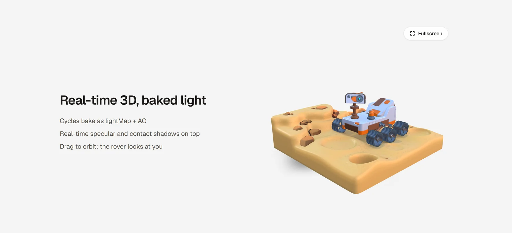

# Next.js + R3F: baked + dynamic lighting

Template for embedding real-time 3D in a Next.js site: a Mars rover scene with Blender (Cycles) baked light mixed with three.js real-time shading.

<picture>
  <source media="(prefers-color-scheme: dark)" srcset="docs/screenshot-dark.webp">
  
</picture>

Stack: Next.js 16 (App Router, Turbopack), React 19, three 0.186, @react-three/fiber 9, @react-three/drei 10, Tailwind 4.

```bash
npm install
npm run dev   # http://localhost:3000
```

## How it works

- **Canvas in the section.** The `<Canvas>` sits inside the section's box, so it scrolls natively with the page. A shared fixed canvas with drei `View`s trails the DOM by a frame or more while scrolling.
- **Lazy.** The Canvas and scene load with `next/dynamic` (`ssr: false`). `useOnScreen` mounts them only near the viewport. Phones get a still image; the hidden canvas never starts.
- **Baked light.**
  - Rover: GLB `MeshStandardMaterial` kept, Cycles `COMBINED` bake as `lightMap` (0.5) + AO bake as `aoMap`, so real-time specular/env still shows.
  - Ground: tinted `MeshStandardMaterial` + `lightMap`/`aoMap`, with the bake's normal pass as a `bumpMap`.
  - Rocks: fully baked, unlit `MeshBasicMaterial`.
  - All baked materials are `toneMapped: false` (canvas uses AgX). Textures: `flipY = false`; color bakes sRGB, AO/bump linear.
- **Real-time.** drei `<Stage environment="sunset">` with contact shadows + one directional light.
- **Interaction.** Clamped `OrbitControls`; when an orbit ends the rover's `RoverHead` node eases to face the camera.
- **Fullscreen.** `/rover` shows the same scene at viewport size, phones included. Exit (or Esc) goes back to `/#robot-mars`.
  - `cacheComponents` keeps the demo page (and its canvas) alive, hidden, while `/rover` is open. A three.js object has one parent, so `useModel` clones the cached `useGLTF` scene per canvas.
- **Theme.** Dark by default, toggle bottom-right (saved in `localStorage`). Colors are CSS tokens in `globals.css`; the canvas is transparent, so the scene sits on either theme.
- **Camera.** No animated `Bounds` fit: the camera starts where the fit would end, and backs off on narrow canvases.

## Layout

```
app/                         layout + demo page, rover/ (fullscreen page)
components/canvas/           Scene (the Canvas)
components/canvas/robot-mars assets + Rover, Ground, Rocks, RobotMarsScene
components/dom/              RobotMarsSection, RobotMarsFullscreen, ui
hooks/useOnScreen.ts
public/models/robot-mars/    GLBs (Draco) + bakes
public/draco/                self-hosted Draco decoder (from three/examples/jsm/libs/draco/gltf)
docs/                        README screenshots
```

## Credits and license

- **Code:** MIT, © 2026 [Tridimotion](https://tridimotion.com). If you reuse the 3D viz component, please credit **@tridimotion**.
- **Next.js + R3F setup:** inspired by [pmndrs/react-three-next](https://github.com/pmndrs/react-three-next) (MIT).
- **3D model:** original by [Polygon Runway](https://polygonrunway.com), optimized and baked by Tridimotion. **Not MIT, not for reuse:** see [public/models/LICENSE.md](public/models/LICENSE.md). The Blender `.blend` and bake setup are not included.
- Notices: [THIRD_PARTY_NOTICES.md](THIRD_PARTY_NOTICES.md).
